# Отчёт о выполнении Лабораторной работы: Обработка ошибок, валидация и логирование в FastAPI

**Автор:** Литвинов А.О., группа КБ-241

## Содержание
- [Задание 1. Пользовательские исключения и их обработчики](#задание-1-пользовательские-исключения-и-их-обработчики)
- [Задание 2. Логирование ошибок с Loguru](#задание-2-логирование-ошибок-с-loguru)
- [Задание 3. Валидация данных и кастомная обработка ошибок валидации](#задание-3-валидация-данных-и-кастомная-обработка-ошибок-валидации)
- [Задание 4. Problem Details для ошибок валидации (422)](#задание-4-problem-details-для-ошибок-валидации-422)
- [Задание 5. Самостоятельная работа](#задание-5-самостоятельная-работа)
  - [5.1 Middleware для генерации и прокидывания X-Request-ID](#51-middleware-для-генерации-и-прокидывания-x-request-id)
  - [5.2 Обработчик HTTPException](#52-обработчик-httpexception)
  - [5.3 Валидация сложных паролей](#53-валидация-сложных-паролей)
  - [5.4 Тесты для проверки обработки ошибок](#54-тесты-для-проверки-обработки-ошибок)
- [Вывод](#вывод)

## Задание 1. Пользовательские исключения и их обработчики

Созданы пользовательские классы исключений `CustomExceptionA` и `CustomExceptionB`, единая Pydantic-модель `ErrorResponse` и соответствующие обработчики. При проверке в Swagger UI эндпоинт `GET /test/a/-5` возвращает код `409` (<a href="#fig1.1">Рисунок 1.1</a>), а `GET /test/b/200` - код `404` с единой структурой ответа (<a href="#fig1.2">Рисунок 1.2</a>).

  <a href="images/ex1.1.PNG" target="_blank">
    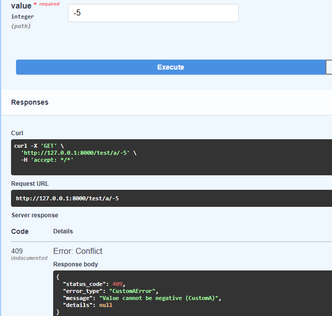
  </a>
  
Рисунок 1.1 - Обработка CustomExceptionA (409 Conflict)

  <a href="images/ex1.2.PNG" target="_blank">
    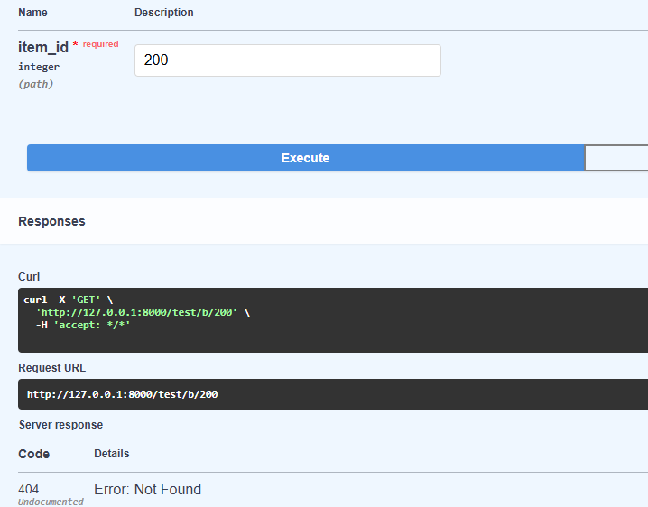
  </a>
  
Рисунок 1.2 - Обработка CustomExceptionB (404 Not Found)

## Задание 2. Логирование ошибок с Loguru

Настроено централизованное логирование с использованием `Loguru`, привязкой полного контекста запроса, маскированием чувствительных данных (`password`, `authorization` и др.) и записью структурированных JSON-логов в файл с ротацией. При вызове `GET /test/boom` клиент получает ответ `500 Internal Server Error` (<a href="#fig2.1">Рисунок 2.1</a>), в консоль выводится подробный трейсбек (<a href="#fig2.2">Рисунок 2.2</a>), а в файл `app.log` сохраняется JSON-запись об ошибке (<a href="#fig2.3">Рисунок 2.3</a>).

  <a href="images/ex2.1.PNG" target="_blank">
    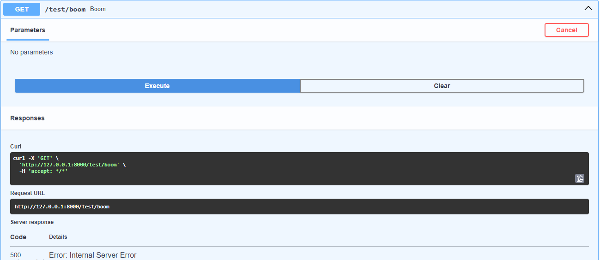
  </a>
  
Рисунок 2.1 - Ответ API при необработанном исключении (500)

  <a href="images/ex2.2.PNG" target="_blank">
    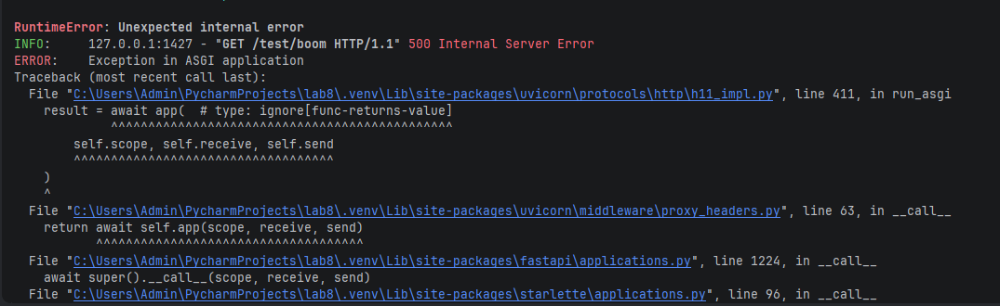
  </a>
  
Рисунок 2.2 - Трейсбек ошибки в консоли

  <a href="images/ex2.3.PNG" target="_blank">
    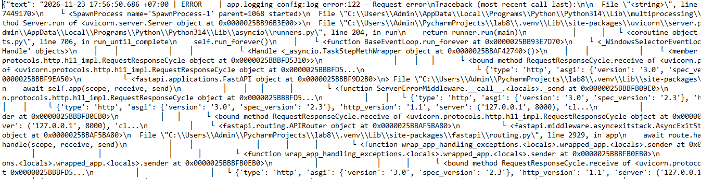
  </a>
  
Рисунок 2.3 - Запись ошибки с контекстом в файле app.log

## Задание 3. Валидация данных и кастомная обработка ошибок валидации

Реализована модель `UserCreate` с валидационными ограничениями и переопределён обработчик `RequestValidationError`. При отправке корректных данных на `POST /users/register` регистрация проходит успешно (<a href="#fig3.1">Рисунок 3.1</a>). При передаче невалидных данных возвращается ответ `422` со списком ошибок в поле `details` (<a href="#fig3.2">Рисунок 3.2</a>, <a href="#fig3.3">Рисунок 3.3</a>), а событие фиксируется в логе (<a href="#fig3.4">Рисунок 3.4</a>).

  <a href="images/ex3.1.PNG" target="_blank">
    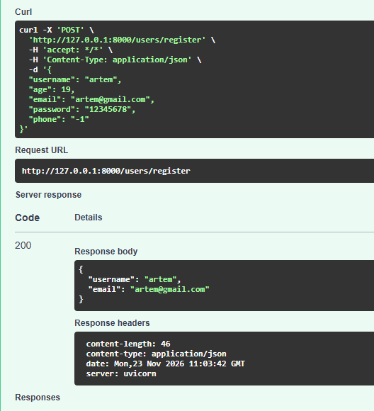
  </a>
  
Рисунок 3.1 - Успешная валидация и регистрация пользователя

  <a href="images/ex3.2.PNG" target="_blank">
    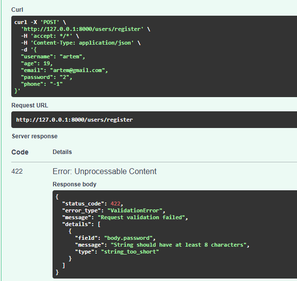
  </a>
  
Рисунок 3.2 - Ответ 422 с детальным списком ошибок валидации

  <a href="images/ex3.3.PNG" target="_blank">
    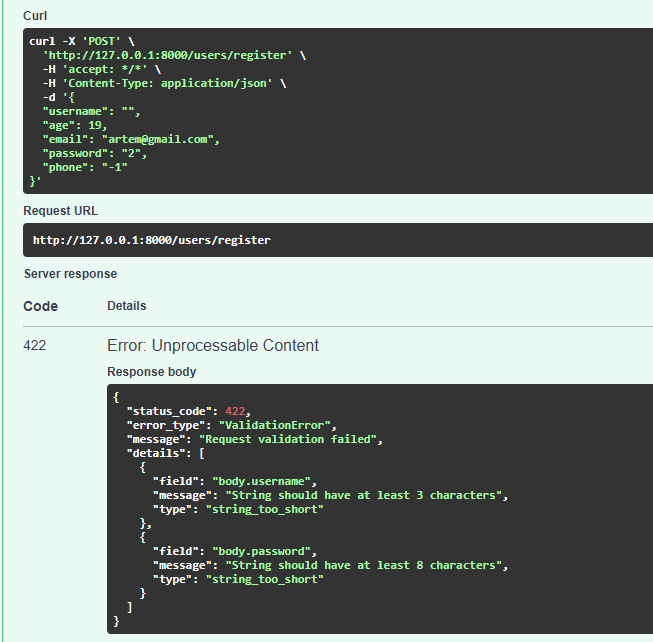
  </a>
  
Рисунок 3.3 - Проверка граничных значений полей модели

  <a href="images/ex3.4.PNG" target="_blank">
    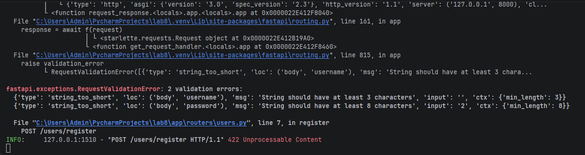
  </a>
  
Рисунок 3.4 - Логирование ошибки валидации в консоли

## Задание 4. Problem Details для ошибок валидации (422)

Формат ответа на ошибки валидации приведён к стандарту **RFC 9457 (Problem Details)** с заголовком `Content-Type: application/problem+json`, а схема и пример ответа задокументированы в OpenAPI (<a href="#fig4.1">Рисунок 4.1</a>). При возникновении ошибки валидации API возвращает структурированный объект `ProblemDetails` (<a href="#fig4.2">Рисунок 4.2</a>).

  <a href="images/ex4.1.PNG" target="_blank">
    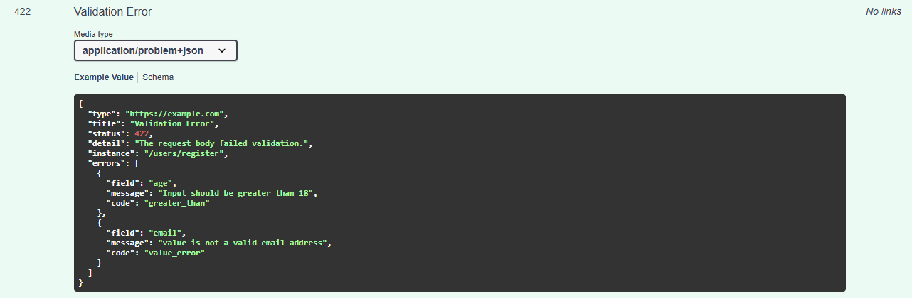
  </a>
  
Рисунок 4.1 - Документация ответа 422 Problem Details в Swagger UI

  <a href="images/ex4.2.PNG" target="_blank">
    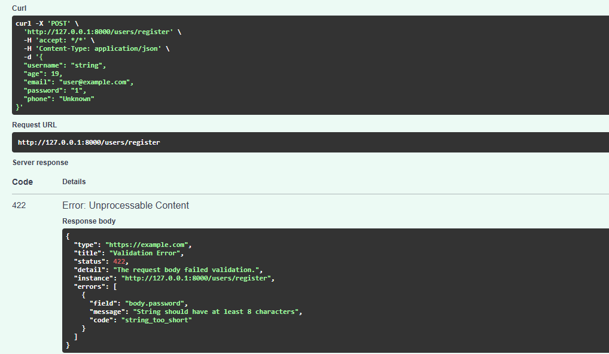
  </a>
  
Рисунок 4.2 - Ответ API в формате application/problem+json

## Задание 5. Самостоятельная работа

### 5.1 Middleware для генерации и прокидывания X-Request-ID
Добавлен HTTP-middleware, который генерирует уникальный идентификатор запроса, сохраняет его в `request.state.request_id`, возвращает в заголовке ответа `X-Request-ID` и передаёт в систему логирования (<a href="#fig5">Рисунок 5</a>).

  <a href="images/ex5.PNG" target="_blank">
    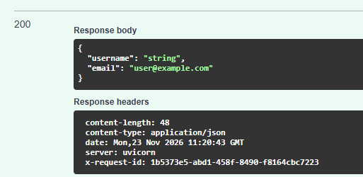
  </a>
  
Рисунок 5 - Заголовок X-Request-ID в ответе сервера

### 5.2 Обработчик HTTPException
Переопределён глобальный обработчик `HTTPException`, благодаря чему стандартные HTTP-ошибки (включая обращение к несуществующим маршрутам) логируются и приводятся к единому формату `ErrorResponse` (<a href="#fig6.1">Рисунок 6.1</a>, <a href="#fig6.2">Рисунок 6.2</a>).

  <a href="images/ex6.1.PNG" target="_blank">
    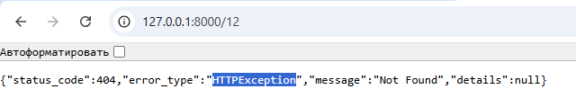
  </a>
  
Рисунок 6.1 - Единый формат ответа ErrorResponse при 404 Not Found

  <a href="images/ex6.2.PNG" target="_blank">
    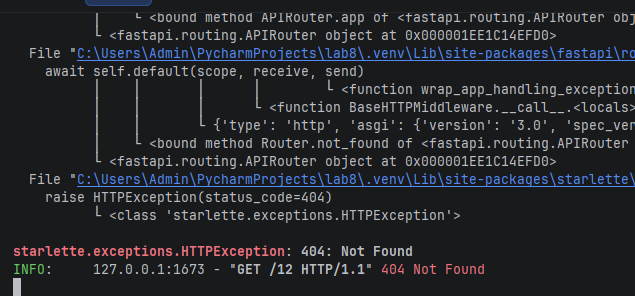
  </a>
  
Рисунок 6.2 - Логирование перехваченного HTTPException

### 5.3 Валидация сложных паролей
С помощью декоратора `@field_validator` в модель `UserCreate` добавлена проверка сложности пароля на наличие минимум одной цифры и одного специального символа (<a href="#fig7.1">Рисунок 7.1</a>, <a href="#fig7.2">Рисунок 7.2</a>).

  <a href="images/ex7.1.PNG" target="_blank">
    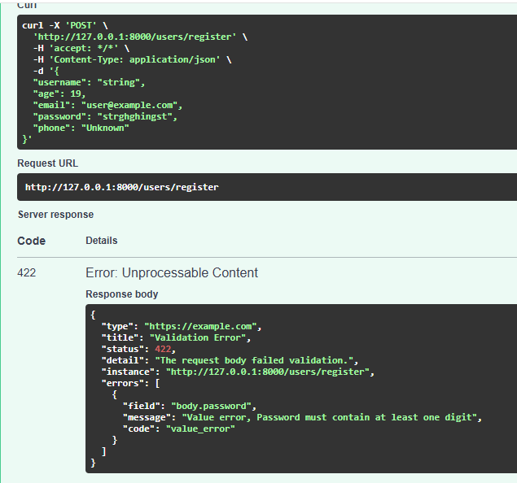
  </a>
  
Рисунок 7.1 - Ошибка валидации при передаче простого пароля (слишком короткий)

  <a href="images/ex7.2.PNG" target="_blank">
    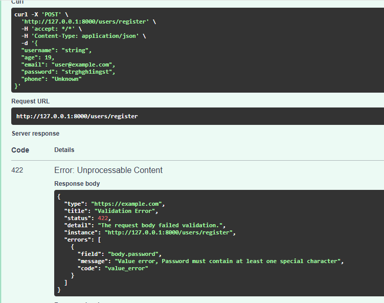
  </a>
  
Рисунок 7.2 - Ошибка валидации при передаче простого пароля (нет спецсимволов)

### 5.4 Тесты для проверки обработки ошибок
Написаны автоматические тесты на базе `pytest` и `TestClient`, покрывающие пользовательские исключения, `HTTPException`, ошибки валидации в формате `ProblemDetails`, неожиданные исключения (`500`) и проверку записи логов в файл. Также в конфигурацию `Loguru` добавлена ротация логов при достижении размера `10 MB` (<a href="#fig8">Рисунок 8</a>).

  <a href="images/ex8.PNG" target="_blank">
    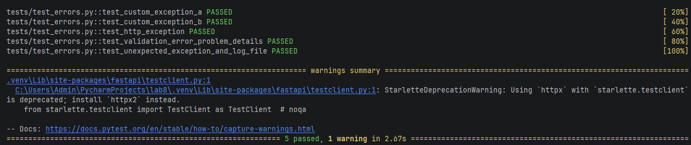
  </a>
  
Рисунок 8 - Успешное прохождение всех тестов pytest

## Вывод

В ходе выполнения лабораторной работы были изучены и реализованы механизмы централизованной обработки ошибок, валидации входных данных и структурированного логирования в FastAPI.

Настроены пользовательские классы исключений, единый формат ответов об ошибках `ErrorResponse` и стандарт **RFC 9457 (Problem Details)** для ошибок валидации с отображением в OpenAPI. Внедрено логирование через `Loguru` с трассировкой запросов по `X-Request-ID`, маскированием конфиденциальных полей и ротацией файлов по времени и размеру, а корректность работы всех обработчиков подтверждена автоматическими тестами на `pytest`.
